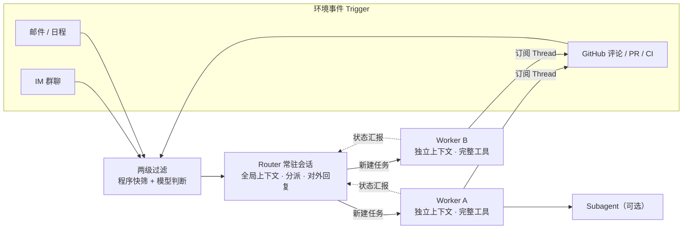

# DeepSeek 与 Super-agent：观点、架构与研究脉络

> 整理日期：2026-11-02 ｜ 类型：学习笔记
> 关键词：DeepSeek Harness、Super-agent、Router/Worker、事件驱动、持续学习

## 导读

2026 年 10 月 31 日晚，DeepSeek Harness 团队发布技术文章《Super-agent 设计探索：迈向更自主的 Agent 系统》，并开源了参考实现 [`dsh-superagent-prototype`](https://github.com/deepseek-ai/dsh-superagent-prototype)（MIT 协议）。

这件事值得单独记一笔，因为它讨论的不是"再做一个更强的模型"，而是一个更偏系统的问题：**当模型完成单个任务越来越不需要人介入时，限制产出的就不再是模型能力，而是人能同时照看多少个 Agent 会话。** Super-agent 给出的答案是：把会话管理、上下文同步和任务调度从人手里移到系统层，让人只负责定目标和验收结果。

这篇笔记按"观点 → 架构 → 实验 → 模型研究 → 局限"的顺序整理，最后附上时间线和资料来源。文中官方信息与媒体转述会分开标注。

---

## 1. 问题背景：注意力成了新的瓶颈

### 1.1 单任务 Agent 已经够用，多任务管理还不够

过去两年，Coding Agent 证明了"模型 + 工具 + 循环"可以端到端完成复杂任务。人越来越多地退到决策和验收的位置。但现有 Agent 基本以**单个 Session** 为单位工作，一旦任务变多，就会遇到几个结构性限制：

- **串行**：一个 ReAct Loop 一次只能推进一条任务线；
- **同步阻塞**：工具执行期间，会话无法接收新指令；
- **上下文混杂**：多个任务挤在一个窗口里，细节互相干扰；
- **设备绑定**：本地 Agent 依赖同一台机器，电脑休眠或离线就停摆。

团队观察到一个很具体的数字：**一个人通常只能同时跟进 3 到 5 个活跃会话**。也就是说，多任务的上限正在从"模型能力"转向"人的注意力"。

### 1.2 一个日常例子

用户在 IM 群里定了方案 A，随后又在 GitHub PR 评论里把方案改成 B。这两条信息落在两个会话里，现有 Agent 往往需要用户自己搬运上下文。Super-agent 想做到的是：用户始终感觉只在和一个 Agent 打交道，会话怎么拆、上下文怎么同步，由系统在底层处理。

---

## 2. DeepSeek 的核心观点

### 2.1 四个基础特征

DeepSeek 把 Super-agent 概括为一个"连续实体"，具备四个特征：

| 特征 | 含义 |
| --- | --- |
| **连续** | 在 IM、GitHub 评论等熟悉界面里交互，跨渠道理解同一件事；用户不必关心"哪个 Session 里有什么上下文" |
| **高效** | 不用等上一条命令或任务结束就能接新指令，多个复杂任务并行推进 |
| **主动** | 持续观察环境事件，值得处理的事主动推进，不需要介入时保持安静 |
| **持久** | 始终在线，接入真实工作环境，长期运行中遇到异常能自己恢复 |

### 2.2 "尽可能少占用人的注意力，尽可能多给出价值"

这是开源原型 `docs/000-philosophy.md` 的第一条原则，也是理解整套设计的关键。它落到具体行为上就是：

- 只在被请求、或团队写好的规则允许时才行动；
- 只在有人需要决策、或能直接用上结果时才说话；
- 一次只问一个具体问题；
- 按影响面停止，而不是按工作量停止；
- 草稿标明未完成，失败就报失败，不绕过限制。

换句话说，**Agent 的能力越强，越要克制它对团队注意力的消耗**。这与很多"让 Agent 多说话、多汇报"的产品直觉是相反的。

### 2.3 Session 应该是实现细节，而不是用户的认知负担

传统 Agent 产品把"会话"暴露给用户：开一个新窗口、切一个上下文、手动 @ 某个 Agent。Super-agent 的观点是：**Session 是系统内部实现，用户面对的应该是一个连续的协作者**。任务怎么拆、由哪个 Worker 执行、上下文怎么同步，都不应该成为用户的负担。

### 2.4 人的位置上移：从执行到目标与验收

模型接管执行细节后，人的角色不是消失，而是上移：

- 人负责**目标设定**与**结果验收**；
- AI 负责**任务分派**与**执行推进**；
- 系统负责**会话管理与上下文同步**。

也可以这样理解"Super-agent"里的"super"：不是单个模型更强，而是系统把人从多任务协调中解放出来。

### 2.5 不提出新理论，把计算机系统的经典思想搬进 Agent

团队明确说，这套设计没有提出全新理论，而是把调度、缓存、存算分离、看门狗等计算机系统里的经典思路用到 Agent 架构上。他们认为：**相似的设计约束会导出相似的架构选择**。无论是个人助手还是团队研发场景，只要目标是"持续在线、并发响应环境事件"，底层大概率会收敛到相近的结构。

### 2.6 这是一次架构探索，不是正式产品

DeepSeek 反复强调：Super-agent 是面向工程实践的架构思路探讨，原型"仅供参考，不是 DeepSeek 正式产品"。原型 README 也写明：代码大量由 Coding Agent 完成，可能有 Bug，且与内部版本、技术文章描述的实现并不完全一致。

### 2.7 更长的一条线：Agent 不是终点

据媒体报道的梁文锋投资人交流会内容（2026 年 7 月，非官方发布，需谨慎引用），DeepSeek 把通往 AGI 的路线拆成连续台阶：

> 语言模型 → CoT（思维链）→ Agent → 持续学习 → 自我迭代（奇点）→ 具身智能

在这个视角里，Agent 是当下最重要的一级台阶，但**Agent 之后的下一个瓶颈是持续学习**。梁文锋的判断大意是：AI 现在还不能替代员工，因为它不能像人一样到公司学习两个月；一旦具备持续学习能力，才可能真正替代大量工作。

这也解释了 DeepSeek 为什么一边做 Agent 产品化，一边把研究重点放在"学习如何学习"上。官方 V4 发布说明里的表述则是更克制的版本："we remain committed to longtermism, advancing steadily toward our ultimate goal of AGI."

---

## 3. 架构拆解：五个模块

技术文章把支撑四个特征的机制归为五个模块。下面按"它解决什么问题"来拆。

### 3.1 双层架构：Router 只分派，Worker 只干活

这是整套设计的主干。它要解决的是一个根本权衡：

- 全部放进一个 Session：上下文最连续，但串行、吞吐低、细节混杂；
- 全部开独立 Session：吞吐最高，但缺少全局上下文，结果割裂、交互混乱。

DeepSeek 的解法是把"维护全局连续性"和"高并发执行"拆成两层：

**Router 层**是常驻的全局协调节点，负责承接所有入口的人类交互，汇总跨任务的信息与决策。它不直接执行具体任务，甚至可以不配 Bash 工具。实践中 Router 用较轻量的模型往往就够，因为它每步通常是"长输入、短输出"。

一个容易被忽略的工程细节：Router 并不会像想象中那样容易成为吞吐瓶颈。上一轮推理期间到达的事件会积压下来，在下一轮一并处理，形成**批处理**。事件越密集，合并处理的收益越明显；上限取决于上下文长度和模型一轮能准确处理多少条 Trigger。

**Worker 层**由具体执行任务的会话组成，各自上下文隔离、挂载完整工具、专注单一任务。Worker 不直接对外说话，而是把状态汇报给 Router，由 Router 统一回复——这样既保证并发，又避免多个会话同时输出造成混乱。Worker 通常需要配置能力最强的模型，因为它的输出直接决定任务结果和代码质量。

与常见的 Agent Team 相比，这里的重点不同：Agent Team 通常用于单个复杂任务内部的步骤拆解，Team Lead 需要深入任务细节；而 Super-agent 的 Router 只处理**任务之间**的高层关联与分派，不介入单任务内部拆解。

### 3.2 事件驱动：环境事件就是输入

要让 Agent 主动，首先得改变它的驱动方式：主要输入不再是人类逐条键入的提示词，而是环境中的半结构化事件。群聊消息、邮件与日程提醒、代码审查评论、CI 结果，都被称为 **Trigger**。

真实环境的事件流是"高噪音、低触发率"的。如果每条消息都调用大模型判断，延迟和成本都不可接受。于是有了两级过滤：

| 层级 | 机制 | 作用 |
| --- | --- | --- |
| **程序层（Fast Path）** | 按来源、群组、白名单等确定性条件用代码快速筛选 | 在调用模型前滤掉大部分噪音 |
| **语义层（Slow Path）** | 剩下的候选事件交给 LLM，按提示词里的策略判断是否行动 | 处理需要语义理解的边界情况，也是自然语言扩展点 |

过滤之后，事件按 **Thread** 组织：同一个 GitHub PR、同一个 IM 话题、同一封往来邮件下的连续事件构成一条事件流。

还有一个很有想象力的机制：**投机执行**。Agent 在结果是否会被采用尚不确定时，先在后台提前尝试；有价值就交付，没有就丢弃。DeepSeek 内部配置了一条"静默复现并修复"策略：群里有人反馈 Bug 时，Agent 先在后台复现、分析，只有确认问题存在并找到简单修复方案后才提交，否则全程保持安静。

### 3.3 订阅直通：后续事件不再绕 Router

如果每个已分配任务的后续事件都要经过 Router 转发，这个全局节点仍然会承受大量负载。因此路由也分快慢两条路径：

- **已订阅（Fast Path）**：Worker 接手某个 Thread 后直接订阅它，后续事件由程序直接发给 Worker；
- **未订阅（Slow Path）**：Router 仍能看到所有事件以掌握全局，但只负责判断和分派还没人认领的新事件。

订阅是多对多的：一个 Worker 可以订阅多个 Thread，同一个 Thread 也可以被多个 Worker 订阅。多个 Worker 在同一个 PR 里发生交集时，会收到相同的事件通知，从而有机会自己发现并解决冲突，不需要点对点通信。输出侧仍由 Router 统一对外。

### 3.4 上下文当缓存管理：Inline & Spill 与链式召回

事件进入 Session 后，下一个问题是"往上下文窗口里塞多少信息"。塞多了挤占窗口、稀释注意力；塞少了模型要反复调工具读取，增加步数。文章里有一句话很值得记：

> 浪费上下文窗口，就是浪费模型的智能。

做法是把上下文窗口当 Cache 管：

- **Inline**：把近期很可能用到的信息直接内联进当前窗口，省去工具调用往返；
- **Spill**：超出预算或低频的完整信息留在窗口外，窗口内只保留引用或摘要，需要时再读。

配合局部性思想，注入策略可以逐步细化：先给对象 ID 和摘要；再内联紧密关联的 ID、前后文、相邻消息；超出上限就截断并保留"续读入口"。

当系统长期运行、积累大量历史任务后，Router 还需要在用户跨渠道提起旧任务时找回上下文。把 Inline & Spill 一致地应用到 Trigger、Thread、Worker Session 等对象上，就得到**链式召回**：每个对象都内联下一跳关联对象的 ID，模型可以顺着引用关系逐跳展开，形成一张可导航的上下文图。

### 3.5 面向人的交互：异步 ReAct Loop 与多信道表达

**异步 ReAct Loop** 解决"后台干活时前台卡住"的问题。经典 ReAct Loop 里，模型发起一次同步的 `run()` 工具调用后，循环会阻塞到工具返回。Super-agent 把耗时命令改成异步的 `start()` / `stop()`：模型调用 `start()` 后立即收到"已启动"，循环继续；后台完成后，结果作为一条新事件投递回会话；模型也可以调用 `stop()` 终止执行过长的命令。

这样，对话就从"一问一答的半双工"变成"全双工"：后台在跑耗时任务，前台仍能接新指令。文章透露，这个机制已在 DeepSeek Harness 中实现，但尚未默认开启。

**多信道表达**则是让输出匹配不同渠道的习惯：

- **IM 等即时通讯**：低打扰、轻量沟通，只在需要决策或验收时发通知，只问直接问题、给简短结论；团队验证过一条硬规定——单次回复不超过 100 词。
- **GitHub、邮件、文档等异步信道**：结构化、高信息密度，PR 按项目规范写完整的问题背景、改动说明和验证结果。

同一个 Agent，在不同信道里说不同密度的话，这是"连续"体验的一部分。

### 3.6 存算分离与外部 Watchdog：持久在线

现有本地 Agent 把三样东西绑在同一台设备上：推进 Agent Loop 的计算、需要持久保存的会话状态、代码仓库与本地工具链。设备一休眠，Agent 就停了。

Super-agent 分两步解耦：

1. **计算与状态分离**：Agent Loop 的计算放云端，会话状态单独存数据库，摆脱单机生命周期；
2. **云端 Loop 与执行环境解耦**：代码仓库、本地工具链留在原地，通过统一接口按需接入。

这样 Agent 不再受限于单台机器，可以在不同执行设备之间切换，也支持间歇在线的个人设备：设备重新上线后，云端 Agent 再触发需要在该设备上完成的任务。

文章指出，这与 Anthropic 提出的"脑手分离"思路一致；区别在场景：Anthropic 那篇主要讨论托管服务和沙箱，而 Super-agent 首先要接入的是用户日常使用、可能间歇在线的个人机器，上面有未提交修改和本地凭据。

**外部 Watchdog** 解决长期运行的可靠性。持久在线的分布式系统很难只靠主系统内部逻辑保证长期可靠，需要在主系统之外引入独立的控制回路。而且 Agent 的异常不一定是进程崩溃，更常见的是模型陷入无效循环或偏离目标。因此 Watchdog 不只盯基础设施，还要由模型判断各 Worker 是否有实质进展、方向是否偏离。它本身也是一个具备完整工具能力的 Agent Session，维护者可以用自然语言问它故障原因，也可以让它在线调整提示词或触发规则。

### 3.7 一张表：计算机系统概念 → Agent 设计

| 计算机系统概念 | Super-agent 中的对应 |
| --- | --- |
| 调度器 / 进程隔离 | Router 分派 + Worker 独立上下文 |
| Fast Path / Slow Path | 程序层过滤 + 模型语义判断 |
| 事件总线 / 订阅 | Thread 订阅与直通 |
| Cache / 局部性 | Inline & Spill、链式召回 |
| 投机执行 | 后台先复现，确认后再交付 |
| 存算分离 | 云端 Agent Loop + 独立状态库 + 本地执行环境 |
| Watchdog / Control Loop | 外部巡检 Session |

这张表基本就是文章的论证方式：**Agent 系统正在变复杂，很多问题在操作系统和分布式系统里已经有人想过。**

---

## 4. 初步实验：用更多 Token 换更短、更稳的完成时间

团队用群聊和 GitHub CI 消息流做了消融实验：单次约 300 条消息，其中约 20 条工作请求，编码工作用只耗时工具代替，每种方案跑 5 次。

| 方案 | 任务完成时间 p50 | 任务完成时间 p95 |
| --- | --- | --- |
| Super-agent（双层架构 + 订阅直通） | **12.4 分钟** | **15.7 分钟** |
| 单 Session + Subagent 工具（中性提示） | — | 29.5 分钟（5 次都没调用 Subagent） |

另外两组数据：

- **订阅直通省 Token**：去掉直通后，完成时间基本不变，但 Router 决定数增加约 30%，读缓存 Token 从 2,323 万涨到 3,177 万，增加约 37%。直通不提速，但为 Router 省下可观的 token 与推理开销。
- **Router 越堵，单个决定越便宜**：Trigger 到达速率从每分钟约 1 条升到约 40 条，平均 batch 从 1.0 升到 2.8，单次请求耗时只从 2.5 秒增到 3.9 秒，单个决定分摊的推理时间从 6.4 秒降到 1.6 秒。

**需要保留的限定**：实验基于合成负载和简化环境，没有评估真实编码质量；Super-agent 维护多个会话，读缓存 Token 本身就高于单会话方案。团队自己说，这些结果只作初步参考。更准确的结论是：**它用更多 token 换来了更短、更稳定的完成时间**。

---

## 5. 模型侧的研究支撑：Agent 能力不是凭空来的

Super-agent 是系统层的架构，但它能成立，前提是模型本身具备足够强的工具调用、长上下文和推理能力。把 DeepSeek 近两年的发布串起来看，能看到三条相互配合的主线。

### 5.1 时间线

| 时间 | 发布 | 与 Agent 相关的要点 |
| --- | --- | --- |
| 2024-12 | DeepSeek-V3 | MoE 架构，低成本高性能基座 |
| 2025-01 | DeepSeek-R1 | 用强化学习激发推理能力，验证"思考"路线 |
| 2025-08 | DeepSeek-V3.1 | 官方称"迈向 Agent 时代的第一步"；Think / Non-Think 混合推理；后训练强化工具调用与多步 Agent 任务 |
| 2025-09 | DeepSeek-V3.2-Exp | 引入 DeepSeek Sparse Attention（DSA），长上下文更高效，API 降价 50%+ |
| 2025-12 | DeepSeek-V3.2 | DeepSeek 首个把"思考"融入工具使用的模型；大规模 Agent 训练数据合成（1,800+ 环境、85,000+ 复杂指令）；开源模型 Agent 评测最高水平；Speciale 版在 IMO/CMO/ICPC/IOI 2025 拿金牌 |
| 2026-04 | DeepSeek-V4 预览 | 1M 上下文成为默认；V4-Pro 1.6T 总参 / 49B 激活，V4-Flash 284B / 13B；开源模型 Agentic Coding SOTA；与 Claude Code、OpenClaw、OpenCode 等集成 |
| 2026-08 | DeepSeek-V4-Pro 正式版 | Agent 能力升级；可调推理强度（low / high / max）；原生 OpenAI Responses API，适配 Codex |
| 2026-09 | DeepSeek-V4.1-Flash | 552B MoE，非对称编解码架构（输入 8B / 输出 16B 激活）；KV cache 仅需前代 1/4 HBM、1/8 SSD |
| 2026-10 | DeepSeek-V4.1-Flash-1017 | 基于自反馈强化学习增强"从零构建完整项目"的能力；主打"许愿式编程"（Wish-Driven Programming）；针对 DeepSeek Harness 等框架优化 |

### 5.2 三条主线

**第一条：推理能力。** R1 验证了强化学习可以激发长链思考；V3.2 把思考带进工具调用；V4-Pro 正式版把推理强度做成可调参数。对 Agent 来说，这意味着模型可以在"想清楚"和"快速执行"之间按任务难度切换。

**第二条：Agent 能力。** V3.1 开始系统性强化工具调用和多步任务；V3.2 用大规模合成环境做 Agent RL；V4 把 Agentic Coding 做到开源 SOTA；V4.1-Flash-1017 进一步走向"从零构建完整项目"。这条线的关键词是：工具使用、长上下文、真实环境泛化、端到端交付。

**第三条：效率与成本。** MoE、MLA、DSA、KV cache 压缩、非对称架构——这些看似"模型侧"的工作，对 Agent 同样关键。因为 Agent 的一次任务往往包含几十上百次模型调用，token 成本和缓存成本会被放大。V4.1-Flash 特别提到"cache-hit 费用在 Agent 成本中占比很高"，并把 KV cache 压到前代的 1/4 HBM、1/8 SSD。**在 Agent 时代，推理效率不是附属品，而是产品可用性的一部分。**

### 5.3 模型与 Harness 的共同演进

DeepSeek 的一个特点是模型和 Harness 一起迭代：V4 发布时强调"已驱动 DeepSeek 内部的 agentic coding"；V4.1-Flash-1017 明确建议升级到 DeepSeek Harness v0.2.1-rc.1 以上以获得最佳体验；Super-agent 则直接构建在 Harness 之上。

这背后的判断是：**Agent 的能力上限不只由模型决定，也由模型外面的那层系统决定。** 同样的模型，放在一个只能单会话、同步阻塞的壳里，和一个有 Router/Worker、事件驱动、上下文管理的系统里，产出可能差很多。

---

## 6. 与业界其他方案的差异

| 对比对象 | 主要差异 |
| --- | --- |
| **单机 Coding Agent**（Claude Code、Codex 等） | 后者主要是人在终端/IDE 里开一个会话交互；Super-agent 是常驻进程，从 GitHub、IM 等渠道接收事件，自己开会话、分派任务，人只在决策和验收时出现 |
| **Agent Team** | Agent Team 侧重单个复杂任务内部的步骤拆解，Team Lead 需要深入任务细节；Super-agent 的 Router 只做任务之间的高层分派，本身不执行具体任务 |
| **Anthropic 的"脑手分离"** | 都强调计算、状态、环境解耦；Anthropic 主要讨论托管服务和沙箱，Super-agent 首先面向用户日常使用、可能间歇在线的个人机器（BYOM） |
| **个人助手** | 架构可以复用：前端仍是一个聊天框，底层按话题分派多个 Worker 并行推进 |

一个值得注意的点：Super-agent 并没有把"多 Agent"当成目的。它更像是用系统设计把"一个 Agent"的体验做连续，至于底层有几个 Session、几个 Worker，用户不需要知道。

---

## 7. 开放问题与局限

技术文章自己列了四个开放问题：

1. **双层架构如何扩展**：单个 Router 承载超限后何时切分、粒度如何、Worker 之间何时需要直接通信，都还没有定论；跨月长程记忆也是瓶颈。
2. **脱离 Session 后如何协作**：聊天窗口未必是最终形态，交互可能更多发生在 GitHub 等领域界面；还需要支持用户中途介入、接管和实时协同。
3. **上下文边界与 A2A**：组织扩大后，多个隔离实例之间如何划分上下文、如何通信协作，仍待探索。
4. **安全与隐私**：云端 Agent 接入端侧凭据，存在被入侵和提示词注入的风险；还需要让 Agent 不接触凭据本身也能使用凭据。

除此之外，还有几点工程上的现实限制：

- **原型不是产品**：README 明确说代码大量由 Coding Agent 完成，可能有 Bug，与内部版本不完全一致，不建议直接用于生产。
- **权限很大**：原型默认以 danger-full-access 运行，能按路径执行程序、读取用户主目录；官方建议用独立系统账号跑。
- **自动合并先别开**：SETUP.md 的推荐答案是"否"，等 Agent 的 PR 持续一段时间没问题后再考虑。
- **主动模式默认只观察**：默认 accept 模式是 observe，主动发起的工作只记录、不执行；建议先只放自己的白名单，看一段时间 Agent"本来会做什么"再放开。
- **Token 成本**：多会话维护的读缓存 Token 高于单会话，省时间和稳定性是有代价的。

---

## 8. 对个人项目的启示

如果只记三句话：

1. **把人的注意力当成一等资源来设计。** 不管是 Agent、通知还是 UI，每一次打扰都要问：它是否值得对方放下手头的事？
2. **系统问题用系统方法解。** 调度、缓存、事件、解耦、看门狗——这些老概念在 Agent 时代仍然有效。不要一遇到多任务就想着"再开一个 Agent"。
3. **先观察，再放权。** 让 Agent 先以只记录、不执行的方式跑一段时间，确认它的判断符合预期，再逐步放开权限。

对学习路径的启示则是：DeepSeek 的路线图把 Agent 放在 CoT 之后、持续学习之前。这意味着**会调工具、能执行任务，只是中间一站**；真正难的是让系统在长期运行中持续学习、修正自己。Super-agent 的 Watchdog、链式召回、跨会话记忆，其实都在为这个更远的目标做工程准备。

---

## 9. 时间线速览

| 时间 | 事件 |
| --- | --- |
| 2024-12-26 | DeepSeek-V3 发布 |
| 2025-01-20 | DeepSeek-R1 发布 |
| 2025-08-21 | DeepSeek-V3.1 发布，"迈向 Agent 时代的第一步" |
| 2025-09-29 | DeepSeek-V3.2-Exp 发布，DSA + 降价 |
| 2025-12-01 | DeepSeek-V3.2 正式版，思考融入工具调用 |
| 2026-04-24 | DeepSeek-V4 预览，1M 上下文 |
| 2026-08-13 | DeepSeek-V4-Pro 正式版 |
| 2026-09-10 | DeepSeek-V4.1-Flash |
| 2026-10-17 | DeepSeek-V4.1-Flash-1017，"许愿式编程" |
| 2026-10-31 | DeepSeek Harness 团队发布 Super-agent 架构文章，开源原型 |
| 2026-11-01 | 国内外媒体集中报道；原型短时间获得大量关注 |

---

## 10. 参考资料

**官方 / 一手**

- DeepSeek Harness 团队：《Super-agent 设计探索：迈向更自主的 Agent 系统》，微信公众号，2026-10-31。
- 开源原型：[deepseek-ai/dsh-superagent-prototype](https://github.com/deepseek-ai/dsh-superagent-prototype)（MIT），含 README、`docs/000-philosophy.md` 等。
- DeepSeek Harness 官网：<https://www.deepseek.com/en/harness/>
- DeepSeek-V3.1 发布说明：<https://api-docs.deepseek.com/news/news250821/>
- DeepSeek-V3.2-Exp 发布说明：<https://api-docs.deepseek.com/news/news250929/>
- DeepSeek-V3.2 发布说明：<https://api-docs.deepseek.com/zh-cn/news/news251201/>
- DeepSeek-V4 预览发布说明：<https://api-docs.deepseek.com/news/news260424/>
- DeepSeek-V4-Pro 正式版说明：<https://api-docs.deepseek.com/news/news260813/>
- DeepSeek-V4.1-Flash 发布说明：<https://api-docs.deepseek.com/news/news260910/>
- DeepSeek-V4.1-Flash-1017 发布说明：<https://api-docs.deepseek.com/news/news261017/>

**媒体解读 / 转述**

- 环球网（新浪财经转载）：[DeepSeek 发布全新 Agent 架构"Super-agent"，让 AI 调度 AI](https://finance.sina.com.cn/roll/2026-11-01/doc-inixeyiz3146996.shtml)，2026-11-01。
- 智东西：[DeepSeek 又开源了！公布 Super agent 架构](https://www.zhidx.com/p/606311.html)，2026-11-01。
- 七牛云：[DeepSeek 开源 Super-agent 是什么：双层架构、主动找活的 Agent 原型怎么部署](https://news.qiniu.com/archives/1793499698327)，2026-11-01。
- 潮新闻：[DeepSeek 发布最新 Agent 架构，让 AI 指挥 AI 干活](https://tidenews.com.cn/news.html?id=3602095)，2026-11-01。
- 人民网日文版：[AI が AI を管理 DeepSeek が新エージェントアーキテクチャ「Super-agent」を公開](https://j.people.com.cn/n3/2026/1102/c94476-20514657.html)，2026-11-02。
- 星岛头条：[DeepSeek 提出 Super-agent 设计架构 工作方式更自主](https://www.stheadline.com/zh-hans/realtime-finance/3632194/DeepSeek%e6%8f%90%e5%87%baSuper-agent%e8%ae%be%e8%ae%a1%e6%9e%b6%e6%9e%84-%e5%b7%a5%e4%bd%9c%e6%96%b9%e5%bc%8f%e6%9b%b4%e8%87%aa%e4%b8%bb)，2026-11-01。
- IT之家（凤凰网转载）：[DeepSeek V4.1 Flash-1017 新版本发布：许愿式编程一键成真](https://tech.ifeng.com/c/8xIZufSArx4)，2026-10-17。
- 36氪（C114 转载）：[DeepSeek 不是理想主义公司，它只是把现实服务于理想](http://www.c114.net.cn/industry/103757.html)，2026-07-24。文中梁文锋交流会内容来自网络流传录音，非官方发布，引用时需注意。

> 说明：本文把官方发布、技术文章转述和媒体解读混编在一起，引用具体数字和判断时请以对应来源为准。Super-agent 仍是研究原型，文中描述不代表 DeepSeek 已发布的产品功能。
